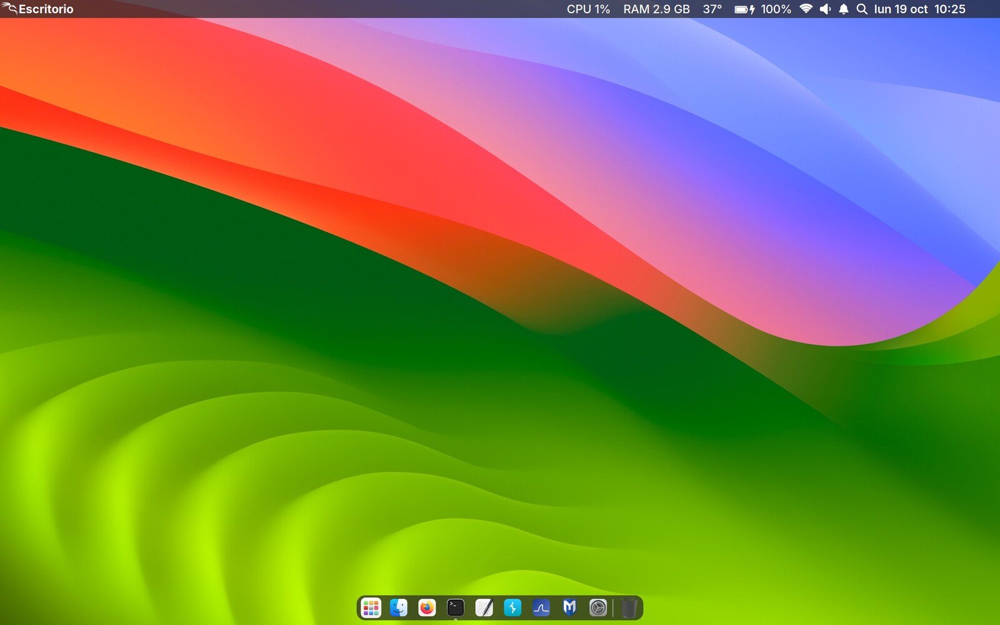
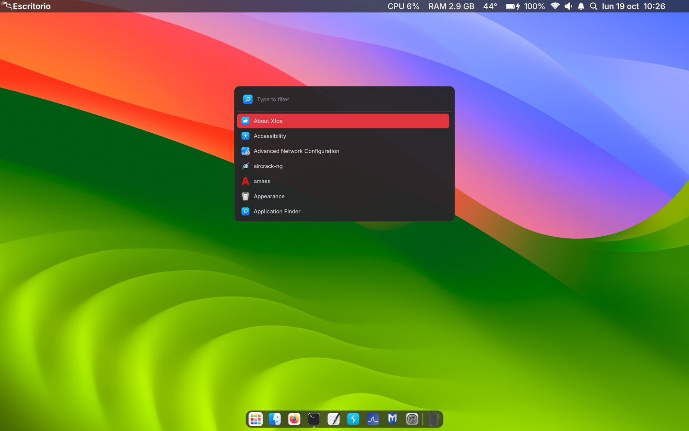
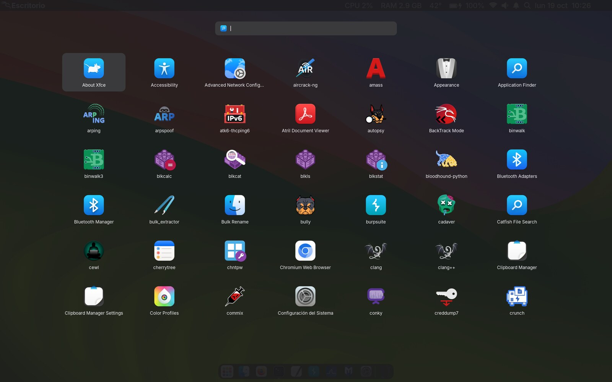
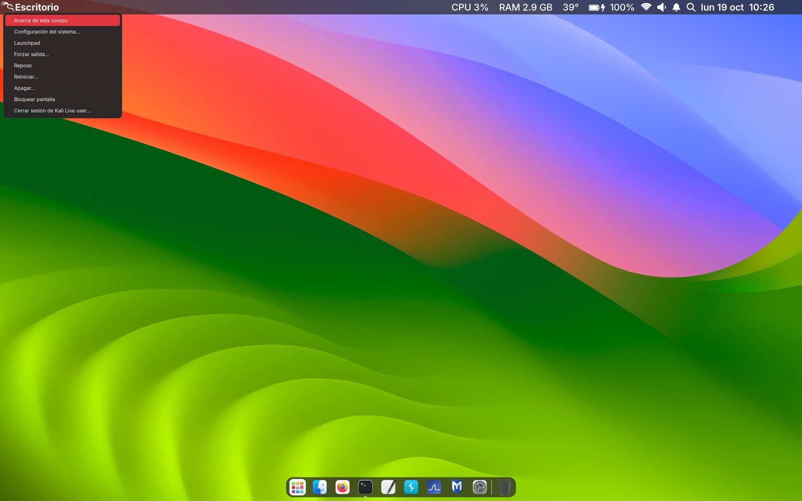
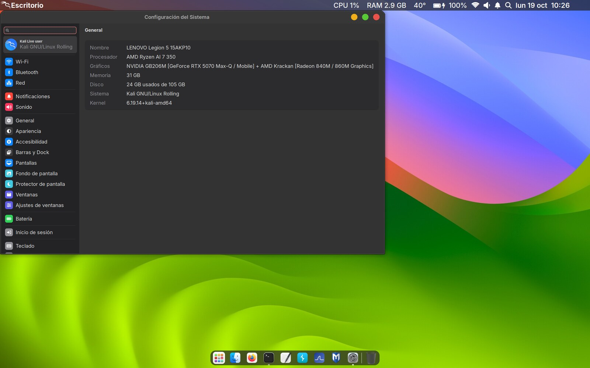

# xfce-estilo-mac

Dejá tu XFCE con el estilo de **macOS** con un solo comando, en cualquier distro: Kali, Debian, Ubuntu,
Linux Mint, Arch, Manjaro, Fedora, openSUSE…



| Spotlight | Launchpad |
|---|---|
|  |  |

| Menú principal | Configuración del Sistema |
|---|---|
|  |  |

## Qué trae

- **Barra de arriba translúcida**, como la de Mac:
  - a la izquierda, el logo de tu distro (abre el menú) y el **nombre de la app activa** en negrita
  - a la derecha, CPU, RAM, temperatura, batería, Wi-Fi, volumen, notificaciones, lupa y fecha, todo en blanco
- **Dock flotante y redondeado**, con Launchpad, tus apps (un puntito marca las abiertas) y la papelera.
- **Spotlight**: <kbd>Super</kbd> + <kbd>Espacio</kbd> o la lupa.
- **Launchpad**: todas las apps en cuadrícula, con <kbd>Super</kbd> + <kbd>A</kbd> o el primer ícono del dock.
- **Menú principal**, como el de la manzanita: Acerca de esta compu, Configuración, Forzar salida, Reposo,
  Reiniciar, Apagar y Bloquear (<kbd>Ctrl</kbd> + <kbd>Esc</kbd>).
- **Configuración del Sistema** al estilo de macOS: lista con íconos de colores a la izquierda y la
  configuración de XFCE adentro, a la derecha.
- **Menú de Wi-Fi** propio: tocás el ícono y elegís la red.
- **Archivos como Finder**: carpetas celestes, sin la barra de menú vieja, barra lateral con selección suave.
- **Firefox como Safari** (tema WhiteSur para Firefox): se instala sin cerrar el navegador y sin borrar tus preferencias.
- **Ventanas, íconos, cursores y fondos** del tema [WhiteSur](https://github.com/vinceliuice/WhiteSur-gtk-theme).
  Las carpetas son celestes, como en Mac. El fondo por defecto es Sonoma, y tenés más en `Imágenes/Fondos`.
- **Alt + Tab** como el Cmd + Tab de Mac: íconos grandes en una caja redondeada.
- **Dividir pantalla**: <kbd>Super</kbd> + flechas (izquierda, derecha, arriba, abajo).
  <kbd>Ctrl</kbd> + <kbd>Super</kbd> + <kbd>↑</kbd> pone la ventana en pantalla completa.
- **Touchpad como en Mac** (opcional): tocar = clic, dos dedos = clic derecho, deslizamiento natural.
- **Letra Inter**, la más parecida a la de Apple.
- Se adapta solo: en pantallas 2K/4K agranda todo, y si la placa de video no tiene aceleración
  (por ejemplo con `nomodeset`), apaga las transparencias para que no se ponga lenta.

## Instalar

Necesitás **XFCE** (4.18 o más nuevo) y estar con tu usuario normal, no root.

```bash
git clone https://github.com/bbenedev/xfce-estilo-mac.git
cd xfce-estilo-mac
./instalar.sh
```

El instalador:
1. instala lo necesario con el gestor de paquetes de tu distro (`apt`, `pacman`, `dnf` o `zypper`)
2. **guarda una copia de tu configuración actual**
3. baja los temas WhiteSur y aplica todo

Te pide la clave de `sudo` solo para instalar programas.

### Opciones

```bash
./instalar.sh --color azul        # color de acento: rojo (por defecto), azul, verde, violeta, rosa, naranja, amarillo, gris
./instalar.sh --touchpad          # configura el touchpad estilo Mac sin preguntar
./instalar.sh --sin-paquetes      # no instala programas (si ya los tenés o tu distro no está en la lista)
```

Si algo no se ve bien al terminar, **cerrá sesión y volvé a entrar**.

## Volver atrás

```bash
./desinstalar.sh
```

Restaura la copia de seguridad que hizo el instalador (está en `~/.config/xfce-estilo-mac/`).

## Requisitos (si instalás a mano con `--sin-paquetes`)

XFCE con estos complementos de la barra: `xfce4-genmon-plugin`, `xfce4-docklike-plugin`,
`xfce4-pulseaudio-plugin` y `xfce4-notifyd`. Además: `rofi` (1.7 o más nuevo), las letras **Inter**,
**Font Awesome** (6 o 5) y **Fira Code**, Python 3 con GTK 3 (`python3-gi`) y `fonttools`,
ImageMagick, `xdotool`, `xprop`, `xrandr`, `xinput`, `sassc`, `git`, NetworkManager (`nmcli`) y
`notify-send`.

## Personalizar

| Qué | Dónde |
|---|---|
| Programitas de la barra y menús | `~/.local/bin/*.sh` |
| Spotlight, Launchpad y menús (diseño) | `~/.config/rofi/*.rasi` |
| Barras redondeadas, Alt + Tab | `~/.config/gtk-3.0/gtk.css` |
| Configuración del Sistema | `~/.local/share/configuracion-mac/configuracion.py` |
| Botones de las ventanas a la izquierda como en Mac | `xfconf-query -c xfwm4 -p /general/button_layout -s "CHM\|"` |

## Créditos

- Temas, íconos, cursores y fondos: [WhiteSur](https://github.com/vinceliuice) de vinceliuice (GPL-3.0).
  Se bajan desde su repositorio durante la instalación; no vienen en este repo.
- Íconos de la barra: [Font Awesome Free](https://fontawesome.com) (CC BY 4.0 / SIL OFL 1.1).
  Se generan en tu compu a partir de la letra instalada.
- Letra [Inter](https://rsms.me/inter/) (SIL OFL 1.1).
- macOS es una marca de Apple Inc. Este proyecto no tiene relación con Apple: solo imita el estilo.

## English

One-command macOS look for **XFCE** on any distro (apt, pacman, dnf, zypper). It includes:
- a translucent top bar with the active app name and white status icons
- a floating rounded dock
- Spotlight and Launchpad (rofi)
- an Apple-style main menu
- a macOS-like *System Settings* app that embeds the XFCE settings dialogs
- WhiteSur themes, Cmd+Tab-style Alt+Tab and optional Mac touchpad gestures

Run `./instalar.sh` (`--color blue` etc.) and undo with `./desinstalar.sh`. A backup of your current XFCE
config is made first. The UI text is in Spanish.

## Licencia

MIT (el código de este repositorio). Ver [LICENSE](LICENSE).
